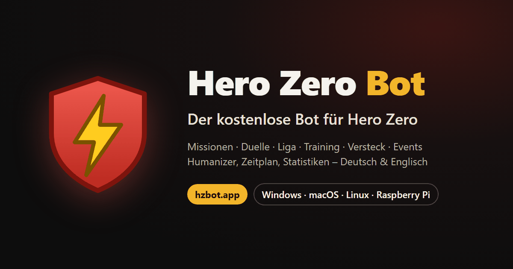
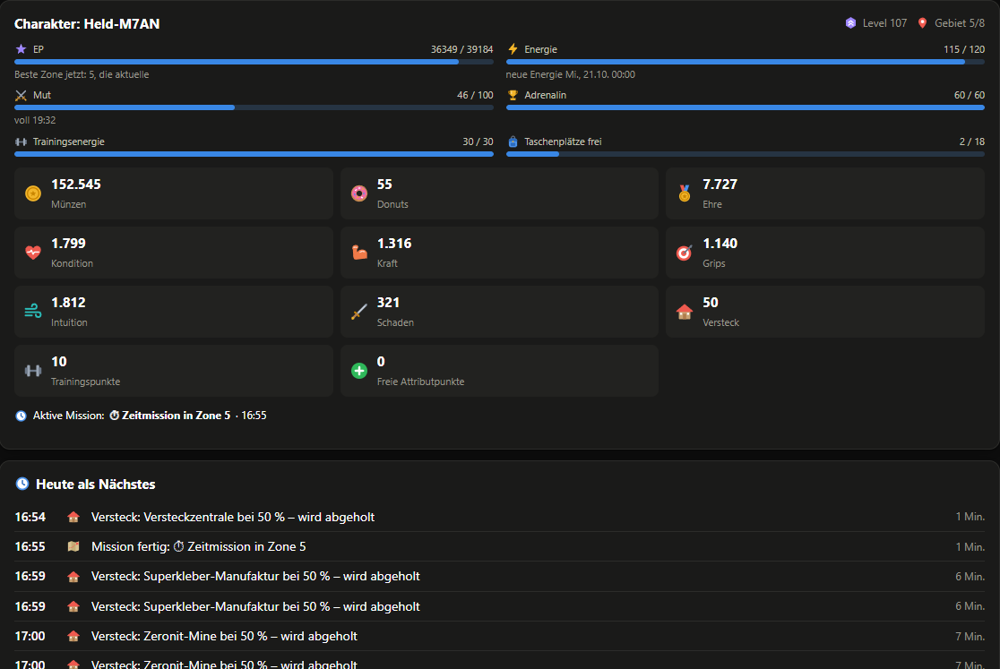
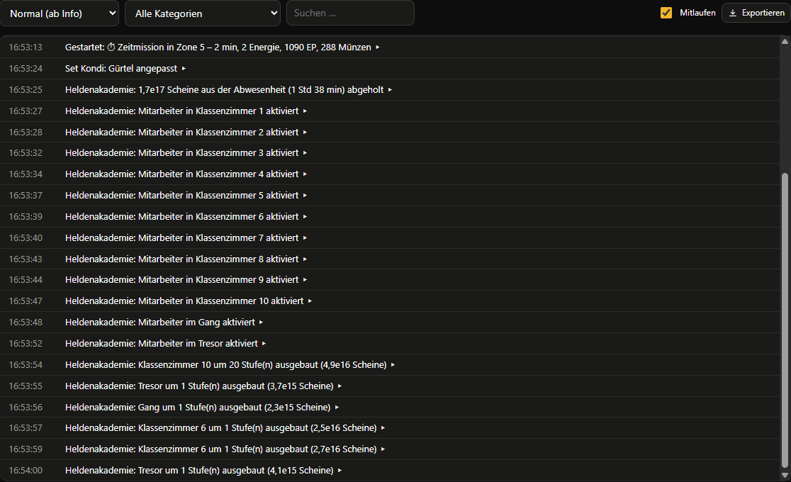
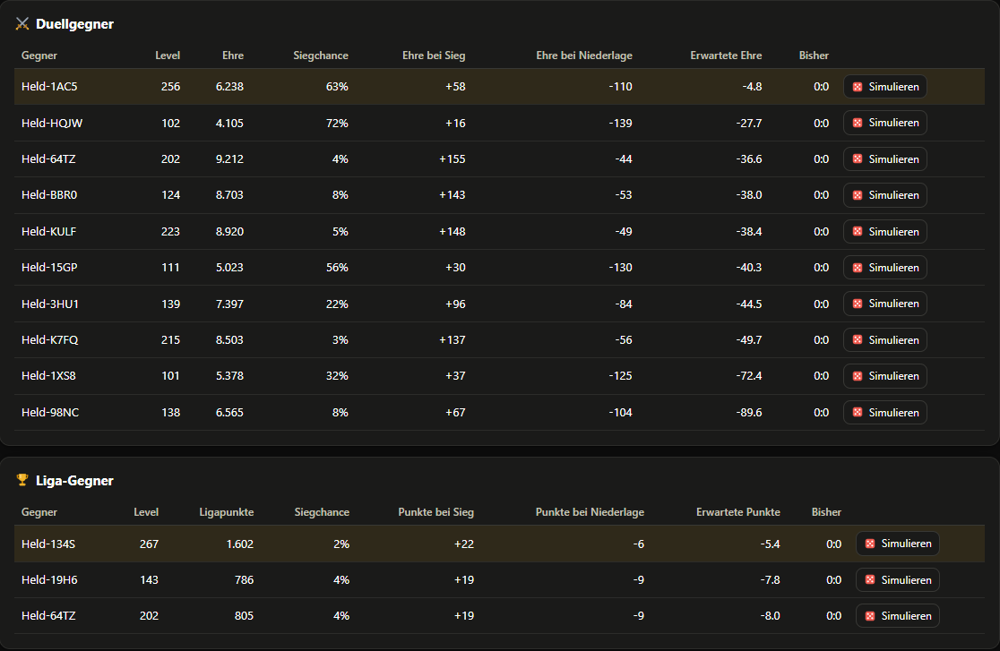
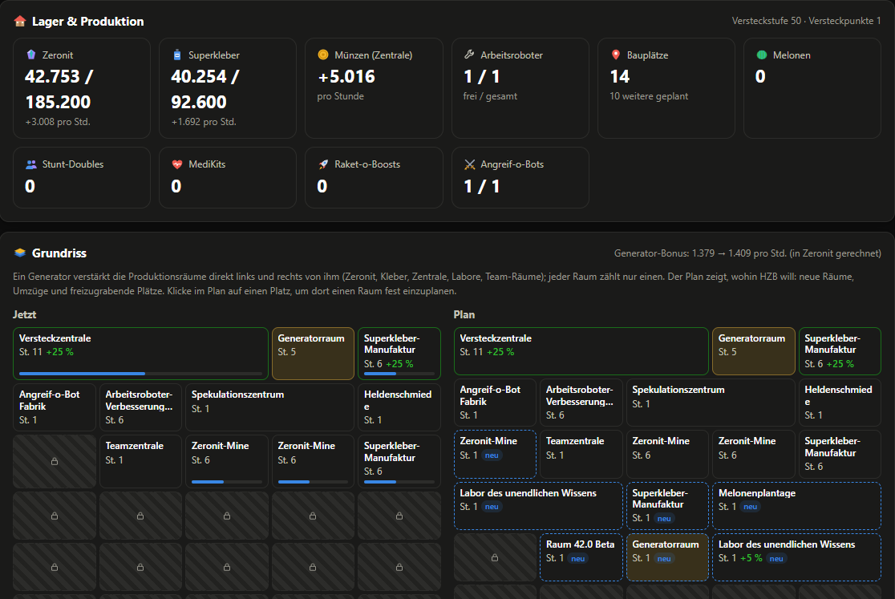

<div align="center">

<a href="https://hzbot.app"></a>

# Hero Zero Bot (HZB)

**Der kostenlose Bot für das Browserspiel *Hero Zero*.**
Missionen, Duelle, Liga, Training, Versteck, Events und Belohnungen – während du etwas anderes machst.

[](https://hzbot.app)
[](https://hzbot.app/downloads.html)
[](https://hzbot.app/neuigkeiten.html)
[](#ist-hzb-wirklich-kostenlos)
[](https://discord.gg/X8ZwgqARXF)

**[🌐 hzbot.app](https://hzbot.app)** · **[⬇️ Download](https://hzbot.app/downloads.html)** · [📖 Anleitung](https://hzbot.app/anleitung.html) · [🆕 Neuigkeiten](https://hzbot.app/neuigkeiten.html) · [Deutsch](#deutsch) · [English](#english)

</div>

---

## Deutsch

Hero Zero Bot (HZB) ist ein kostenloses Programm für Windows, macOS, Linux und den Raspberry Pi,
das das Browserspiel *Hero Zero* für dich spielt – rund um die Uhr oder nach deinem Zeitplan. Er
ist ein eigenständiges Programm, kein Mod und keine Browser-Erweiterung: Er meldet sich wie der
offizielle HTML5-Client an und sendet dieselben Anfragen in derselben Reihenfolge. In das Spiel
wird nichts eingeschleust.

**Download:** [hzbot.app/downloads.html](https://hzbot.app/downloads.html) – Installer für alle
Systeme mit SHA-256-Prüfsummen. **Einrichtung Schritt für Schritt:**
[Anleitung](https://hzbot.app/anleitung.html).

<p align="center"></p>

### Was HZB für dich erledigt

| | Bereich | Was passiert |
| --- | --- | --- |
| 🗺️ | **Missionen** | Bewertet jede angebotene Mission nach Ertrag pro Energie (oder Minute, Münzen, Gegenständen), wechselt das Gebiet, kauft Energie mit Münzen nur, solange es sich lohnt, plant die längste lohnende Mission in Pausen und die Nacht |
| ⚔️ | **Duelle & Liga** | Ein Kampfsimulator mit den Formeln des Spiels schätzt jede Siegchance und lernt aus jedem Kampf gegen denselben Gegner; Mut und Adrenalin werden voll genutzt |
| 🏋️ | **Training & Attribute** | Trainiert, sammelt Sterne und verteilt Kraft, Kondition, Grips und Intuition dorthin, wo die Siegchance gegen deine echten Gegner am stärksten steigt |
| 🎒 | **Gegenstände & Outfits** | Beste Gesamtausrüstung samt Set-Boni und Wurfwaffe; verkauft Ramsch, bewahrt Epics und Sets im **Bankfach** auf, **macht für jede Belohnung Platz** und hält eigene Outfits für Endlosmodus, Missionen und Teamkampf |
| 🏠 | **Versteck** | Plant das ganze Versteck: Grundriss mit Generatoren neben den besten Räumen, neue Bauplätze, Ausbau nach einer Prioritätenliste, die du selbst ordnest; im Team zuerst Teamzentrale und Melonenplantage |
| 🛡️ | **Sondereinsätze** | Kämpft Sondereinsätze, Endlos- und Hardmode nur, wenn die Siegchance stimmt – während der passenden HeroCon jeden Endlos-Kampf |
| 🎉 | **Events & Event-Spiele** | Event-Ziele, Weltboss, Maulwurfjagd (mit Minesweeper-Löser), Strandexpedition, Heldenakademie, Ziehungs- und Suchbild-Events – mit den kostenlosen Versuchen |
| 🎁 | **Belohnungen & Gutscheine** | Login- und Tagesbonus, Heldenbuch, Heldentaten, Saison, Sammlungen, Turniere, HeroCon; Gutscheincodes aus den News und Gutscheine aus dem Chat, wenn sie gebraucht werden |
| 🚀 | **Booster** | Kauft Booster für Münzen nur, wenn sie in ihrer Laufzeit mehr bringen, als sie kosten |
| 👥 | **Team & Begleiter** | Teamkämpfe, Spenden auf Wunsch, Teamsuche, **Teamchat** zum Lesen und Schreiben; der stärkste Begleiter für jede Aufgabe und Begleiter-Pläne, die HZB nach deiner Bestätigung umsetzt |

### Spielt wie ein Mensch

* **Denk- und Reaktionszeiten** statt Klick-Takt, gelegentliche Ablenkungen, manchmal die zweitbeste Wahl.
* **Sitzungen mit Pausen** – nach Zeitfenstern oder mit einem Tagesbudget, das jeden Tag andere Spielblöcke würfelt.
* **Macht Platz, wenn du selbst spielst:** Meldest du dich im Spiel an, pausiert HZB, statt dich hinauszuwerfen.
* **VPN oder Proxy pro Account:** eine WireGuard-Datei (z. B. kostenlos von Proton VPN) – nur der Bot nutzt den Tunnel, und fällt er aus, spielt HZB nicht ohne.

### Er sagt dir, was er tut – und warum

Für jedes Modul zeigt HZB den nächsten Schritt und den Grund – in den Worten des Spiels:

```text
Duelle        Nächstes Duell um 17:55 (Mut lädt)
HeroCon       HeroCon „Unermüdlich im Einsatz“ · zählt: Gewonnene Sondereinsätze · 2301 Punkte · endet Do 20:59
Gegenstände   Ins Bankfach gelegt: Satellitenhandy mit GPS und Flaschenöffner (episch, Stufe 37)
Belohnungen   Heldentat eingelöst: Geisterstunde! (1)
```

<p align="center"></p>

<p align="center"></p>

Das Protokoll lässt sich filtern und als Text oder JSON exportieren; auf Wunsch meldet HZB
Level-Aufstiege, Sperren oder Probleme per **Discord** oder **Telegram**. Die Statistik zeigt,
wie sich deine Attribute über 7, 30 oder 90 Tage entwickeln, und jeden Kampf mit vorhergesagter
Siegchance und Ergebnis. Der **Anonym-Modus** ersetzt alle Namen, damit du Screenshots teilen
kannst – alle Bilder hier sind so entstanden.

<p align="center"></p>

### Donuts sind echtes Geld – HZB gibt keine aus, solange du es nicht erlaubst

Jede Art von Donut-Ausgabe hat einen eigenen Schalter, alle sind aus. Dazu kommen ein
Hauptschalter, eine Mindestreserve und ein Wochenbudget. Einzige Ausnahme: Für einen
Begleiter-Plan, den du selbst bestätigst, gibt HZB genau die angezeigten Donuts aus – die
Mindestreserve bleibt.

### Läuft, wo du willst

| | |
| --- | --- |
| 🖥️ **Desktop-App** | Windows 10/11 (MSI), macOS 10.15+ (Intel, auf Apple Silicon über Rosetta 2), Linux (AppImage, .deb) – läuft beim Schließen im Infobereich weiter, meldet neue Versionen und installiert sie nach deiner Bestätigung |
| 🍓 **Raspberry Pi & Server** | 64-Bit-.deb mit Systemdienst – rund um die Uhr ohne Bildschirm, bedient über die Weboberfläche, auch vom Handy |
| ⌨️ **Kommandozeile** | `hzb-cli` liefert JSON für Skripte: Status, Plan, Kampfsimulation, Statistik, Protokoll |

Beliebig viele Charaktere auf verschiedenen Welten laufen gleichzeitig, jeder mit eigenen
Einstellungen, Statistiken und Zeitplan. Beim ersten Start bist du in drei Schritten
startklar; vier fertige Spielstile (Leveln, Liga, Sondereinsätze, Sparsam) und eigene Vorlagen
– als Datei oder kurzer Code für Discord – sparen das Einstellen.

### Sicherheit und Datenschutz

* **Deine Daten bleiben bei dir.** HZB läuft auf deinem Gerät und speichert dein Passwort
  verschlüsselt; Zugangsdaten gehen nur an die Hero-Zero-Server. Ein Konto bei uns brauchst du
  nicht.
* **Prüfbare Dateien.** Alle Installer werden automatisch gebaut; zu jeder Datei gibt es eine
  SHA-256-Prüfsumme auf der Download-Seite.
* **Ein Fehler stoppt nicht alles.** Lehnt das Spiel eine Aktion ab, wartet nur diese;
  Abstürze werden abgefangen, der Bot startet neu.

### FAQ

<details>
<summary><b>Ist HZB wirklich kostenlos?</b></summary>

Ja, kostenlos für die private Nutzung. Es gibt keine Bezahlversion und keine Funktionen hinter
einer Bezahlschranke. Wer das Projekt unterstützen möchte, kann das über
[Ko-fi](https://ko-fi.com/ruffyg) tun.
</details>

<details>
<summary><b>Wie richte ich HZB ein?</b></summary>

Herunterladen, installieren, Account hinzufügen, Spielstil und Zeitplan wählen, starten – die
[Anleitung](https://hzbot.app/anleitung.html) zeigt jeden Schritt. Für die Anmeldung brauchst
du deine Welt (z. B. `s12`, steht in der Adresszeile des Spiels), deine E-Mail-Adresse und dein
Passwort; das Passwort legst du im Spiel unter *Optionen* fest.
</details>

<details>
<summary><b>Kann ich nebenbei selbst spielen?</b></summary>

Ja. Meldest du dich im Spiel an, endet die Sitzung des Bots; HZB merkt das und macht eine
Pause, statt dich hinauszuwerfen.
</details>

<details>
<summary><b>Warum warnen Windows und macOS beim ersten Start?</b></summary>

Die Installer tragen keine kostenpflichtige Code-Signatur. Windows zeigt „Der Computer wurde
durch Windows geschützt“: *Weitere Informationen → Trotzdem ausführen*. macOS blockiert den
ersten Start (*Rechtsklick → Öffnen* reicht seit macOS 15 Sequoia nicht mehr): die App einmal
öffnen, die Meldung mit *Fertig* schließen, dann *Systemeinstellungen → Datenschutz &
Sicherheit → Dennoch öffnen* und mit dem Passwort bestätigen. Vergleiche im Zweifel die
SHA-256-Prüfsumme mit der auf der [Download-Seite](https://hzbot.app/downloads.html).
</details>

<details>
<summary><b>Wo ist der Quellcode?</b></summary>

Entwickelt wird in einem privaten Repository; dieses hier ist die öffentliche Anlaufstelle. Die
Installer entstehen dort automatisch per GitHub Actions und werden mit Prüfsummen auf
[hzbot.app](https://hzbot.app) veröffentlicht. Was jede Version neu bringt, steht unter
[Neuigkeiten](https://hzbot.app/neuigkeiten.html).
</details>

<details>
<summary><b>Ist die Nutzung erlaubt – kann mein Account gesperrt werden?</b></summary>

Automatisierung kann gegen die Nutzungsbedingungen von Hero Zero verstoßen, eine Sperre ist
also möglich. Mögliche Folgen wie eine Verwarnung oder Sperre trägt allein der Nutzer. HZB
spielt so menschlich wie möglich, eine Garantie gibt es dafür nicht.
</details>

### Links

| | |
| --- | --- |
| 🌐 Website | https://hzbot.app |
| ⬇️ Download | https://hzbot.app/downloads.html |
| 📖 Anleitung | https://hzbot.app/anleitung.html |
| 🆕 Neuigkeiten | https://hzbot.app/neuigkeiten.html |
| 💬 Discord (Fragen, Ideen, Neuigkeiten) | https://discord.gg/X8ZwgqARXF |
| ☕ Unterstützen | https://ko-fi.com/ruffyg |

---

## English

Hero Zero Bot (HZB) is a free program for Windows, macOS, Linux and the Raspberry Pi that plays
the browser game *Hero Zero* for you – around the clock or on your schedule. It is a standalone
program, not a mod or a browser extension: it signs in like the official HTML5 client and sends
the same requests in the same order. Nothing is injected into the game.

**Download:** [hzbot.app/en/downloads.html](https://hzbot.app/en/downloads.html) ·
**Setup guide:** [hzbot.app/en/guide.html](https://hzbot.app/en/guide.html) ·
**What's new:** [hzbot.app/en/news.html](https://hzbot.app/en/news.html)

**What it does:** quests (best reward per energy, zone changes, energy for coins only while it
pays off, the longest worthwhile quest planned into breaks and the night), duels and league (a
battle simulator with the game's formulas that learns from every fight), training and
attributes (where the win chance against your real opponents rises most), items and outfits
(best loadout with set bonuses and missiles; junk is sold, epics and sets are kept in the bank,
room is made for every reward), the hideout as a whole (a layout with generators next to the
best rooms, new room slots, a priority list you order yourself), special missions (endless and
hard mode only when the odds are good), events and event games (world boss, treasure hunt with
a minesweeper solver, beach expedition, hero academy, draw and hidden object events), rewards
and vouchers, boosters that pay off, team and sidekicks with a team chat and sidekick plans
HZB carries out once you confirm them.

**Plays like a person:** thinking and reaction times, sessions with breaks (time windows or a
daily play budget), steps aside when you log in yourself, and if you like a VPN (a WireGuard
file, for example from Proton VPN's free plan) or a proxy per account.

**Explains itself:** for every module the next step and the reason, in the game's own words –
in German or English. Statistics over 7, 30 or 90 days, a fight history with predicted and real
results, filterable logs, notifications to Discord or Telegram, and an anonymous mode that hides
all names for screenshots.

**Donuts are real money:** every kind of spending has its own switch, all off, plus a master
switch, a reserve and a weekly budget. The only exception: a sidekick plan you confirm yourself
spends exactly the donuts it shows – the reserve stays.

**Runs where you want:** desktop app for Windows 10/11 (MSI), macOS 10.15+ (Intel; Apple Silicon
via Rosetta 2) and Linux (AppImage, .deb) that reports new versions and installs them once you
confirm; a 64-bit .deb with a system service for a Raspberry Pi or a server, controlled through
the web interface; `hzb-cli` for scripts. Any number of characters on different worlds at once,
four built-in play styles and shareable templates.

**Free:** for private use, no paid tier, no locked features. Support it on
[Ko-fi](https://ko-fi.com/ruffyg) if you like. The source code is not public.

**Community:** [Discord](https://discord.gg/X8ZwgqARXF)

---

<sub>Hero Zero Bot is an independent project and not affiliated with, endorsed by or connected
to Playata GmbH or Hero Zero. All trademarks belong to their owners. Automation may break the
game's terms of service; use at your own risk. · HZB ist ein unabhängiges Projekt und steht in
keiner Verbindung zu Playata GmbH oder Hero Zero. Nutzung auf eigenes Risiko.</sub>
